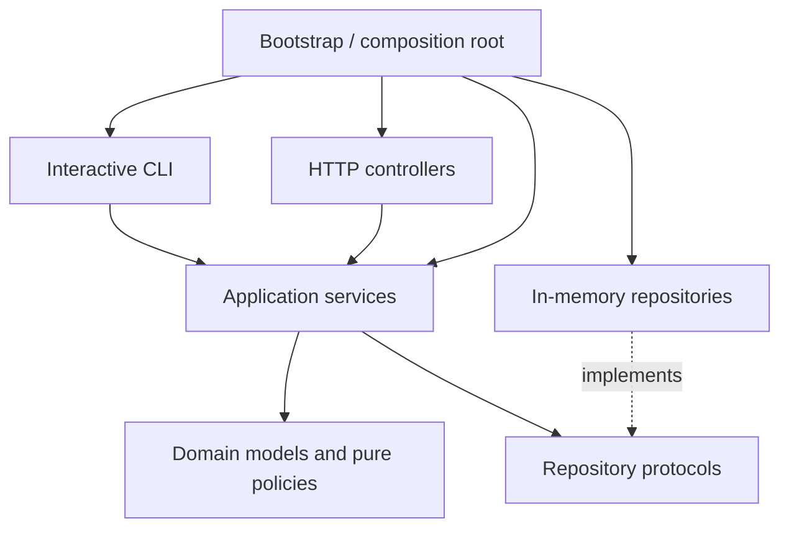
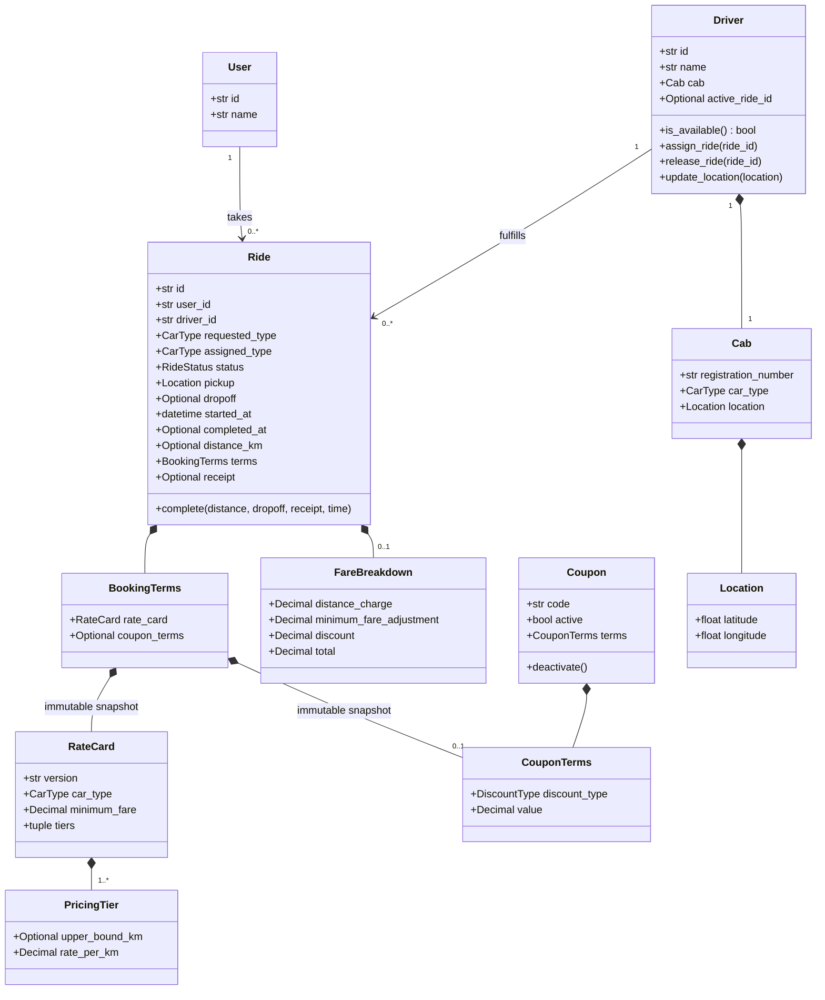
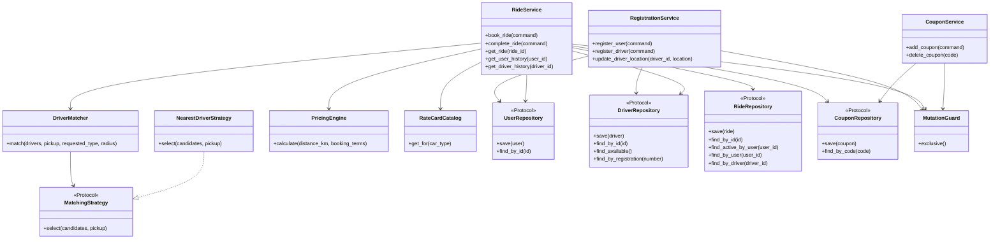

# Backend Engineering Rules — Python Ride Hailing

Status: implementation guidance; project scaffold initialization authorized. Business workflows remain pending implementation.

## 1. Scope and precedence

Read [prd.md](prd.md) before implementation. It defines product behavior, assumptions, acceptance criteria, and delivery scope. This file defines architecture and engineering practices. Explicit user decisions take precedence; update both documents when a decision changes rather than silently diverging.

Keep the solution understandable for a two-hour machine-coding exercise. Use abstractions where they protect actual change boundaries. Do not add infrastructure, patterns, or dependencies solely to resemble a production platform.

## 2. Proposed stack

| Concern | Choice |
| --- | --- |
| Language | Python; pin a supported interpreter version after checking the implementation environment. |
| Models | Standard-library dataclasses, Enum, typed IDs where useful. |
| Money | Decimal with explicit rounding. |
| HTTP | FastAPI, Pydantic boundary schemas, Uvicorn single-worker server. |
| CLI | argparse-based interactive command loop and scripted demo. |
| Tests | pytest; HTTP test client dependencies only as needed. |
| Storage | In-memory dictionaries behind focused repository protocols. |
| Synchronization | One shared threading.RLock for state-changing use cases. |

Verify compatible dependency versions when implementation begins. Define dependencies and test configuration in `pyproject.toml`; use one reproducible dependency workflow.

## 3. Layering and dependencies



- Domain modules must not import FastAPI, Pydantic, CLI parsers, or concrete repositories.
- Application services orchestrate use cases; transport adapters never duplicate business logic.
- Infrastructure implements repository contracts and mutation coordination.
- Bootstrap creates and injects shared instances. Avoid hidden global mutable stores and service locators.
- Use synchronous HTTP handlers for the initial in-memory implementation. Do not mix a threading lock with awaited work inside its critical section.
- Read operations that assemble related mutable state must use the same synchronization boundary or coherent snapshots.

## 4. Domain class plan

The diagram is a responsibility map, not a requirement to create a file or abstract base class for every box. Use functions for stateless calculations and Protocol for useful structural contracts.



Enums: `CarType = HATCHBACK | SEDAN`; `RideStatus = ONGOING | COMPLETED`; initial `DiscountType = PERCENTAGE`. Add FLAT only with its implementation and tests. No unused cancellation states.

Use frozen dataclasses and immutable nested collections for Location, RateCard, PricingTier, CouponTerms, BookingTerms, and FareBreakdown. Frozen outer objects containing mutable lists are not sufficient snapshots. The scaffold also makes User, Driver, Cab, Coupon, and Ride immutable: future lifecycle operations return validated replacements, staged before repository writes. Diagram transition methods describe responsibilities; they need not mutate objects. Optional fields must agree with ride status: completed rides require distance, drop-off, completion time, and receipt. Model invariant checks are implemented alongside the corresponding use cases.

## 5. Service and policy class plan



Haversine distance and discount calculation can be pure functions within matching and pricing modules. Add dedicated strategy classes only when a second implementation justifies them. Inject time and ID generation through simple callables when deterministic tests require them.

## 6. Domain invariants and state transitions

- A driver is available exactly when `active_ride_id` is absent.
- A user and driver each have at most one ongoing ride.
- Successful booking creates one ongoing ride and one matching driver assignment.
- Completion changes ONGOING to COMPLETED exactly once and releases only that ride's driver assignment.
- Requested and assigned car types remain distinct; billing follows requested type.
- Rate and coupon snapshots cannot change after booking.
- A failed operation leaves externally visible state unchanged.
- Histories derive from the ride repository; do not maintain independently mutable history copies.
- Repositories must not expose live mutable entity references to transport callers. Return snapshots or application result objects.

## 7. Matching and atomic mutation

Booking sequence inside the shared mutation boundary:

1. Validate user existence, active-ride restriction, request values, and coupon.
2. Load available drivers and filter by inclusive radius.
3. Form the requested-type candidate set.
4. Only for an empty Hatchback set, form the Sedan fallback set.
5. Rank the selected set by distance, then stable driver ID.
6. Retrieve and snapshot the requested-type rate card and coupon terms.
7. Construct the new ride and updated driver state before modifying storage.
8. Commit both records together and return a detached result.

Eligibility and fallback belong to DriverMatcher; MatchingStrategy ranks eligible candidates only. Do not let a strategy bypass car-type or radius rules.

Use one shared RLock rather than a different lock per service or request. Location updates, coupon mutations, booking, and completion participate in the same boundary. A lock prevents races but does not supply rollback. Stage replacements and make the in-memory commit block free of fallible business validation; if storage gains fallible writes, add an actual transaction/rollback mechanism. Do not claim crash durability or cross-process safety.

Completion validates inputs, returns a stored receipt for completed rides, calculates from snapshots, stages completed ride and released driver, then commits. Invalid completion cannot release a driver. Repeated completion cannot move a driver who has since started another ride.

## 8. Pricing rules

- Follow the formula, rates, rounding order, and reference examples in the PRD.
- Construct Decimal from validated strings or exact integer values, never directly from binary floating-point money values.
- Geographic floats are acceptable for matching; monetary values and billed trip distance use Decimal.
- Reject negative and nonfinite distances and monetary inputs.
- Validate tier bounds are increasing, rates are nonnegative, the schedule starts at zero implicitly, and only the final tier is unbounded.
- Calculate each tier's marginal distance, sum unrounded tier charges, then apply the defined rounding policy.
- Keep raw tier calculation independently testable from minimum fare and discounts.
- Cap discounts at subtotal; ensure all receipt amounts reconcile.
- No repository reads, mutation, or current-time dependence inside pricing calculation.

## 9. Transport and validation

- Shared command/result dataclasses belong in application contracts; Pydantic schemas stay in the HTTP adapter.
- Validate request shape at transport boundaries and enforce business invariants in the core so CLI cannot bypass them.
- Represent money in JSON as two-decimal strings. Use timezone-aware UTC timestamps.
- Keep domain errors independent of HTTP status codes.
- Suggested API mappings: creation 201, normal reads/completion/location update 200, coupon deletion 204; unknown entities 404, assignment conflicts or no driver 409, invalid fields/coupon 422.
- Normalize framework validation errors into the same documented error envelope where practical.
- Do not return internal tracebacks. Preserve useful diagnostics in local logs.
- Interactive CLI catches expected command errors, prints a concise message, and continues. Script/demo failures use nonzero exit status.
- Do not catch all exceptions and report success or return empty data.

## 10. Runtime and packaging

```text
pyproject.toml
README.md
src/ride_app/
    __init__.py
    __main__.py
    bootstrap.py
    domain/
        models.py
        pricing.py
        matching.py
        errors.py
    application/
        contracts.py
        ports.py
        registration_service.py
        ride_service.py
        coupon_service.py
    infrastructure/
        memory.py
        configuration.py
    interfaces/
        cli.py
        api.py
        schemas.py
tests/
    test_pricing.py
    test_matching.py
    test_ride_workflows.py
    test_api.py
    test_cli.py
```

Add package initialization files as needed. Keep modules cohesive; split them when readability requires it, not to satisfy arbitrary class counts.

The interactive CLI owns one application context for its whole session. API bootstrap owns one context for the server lifetime. Run Uvicorn with one worker; multiple workers create isolated stores. Do not imply that standalone CLI and API processes share data. Optional remote CLI mode makes HTTP calls to the API.

## 11. Test strategy

Use table-driven pytest tests for pricing boundaries and examples. Test meaningful externally visible behavior rather than private method calls or trivial getters.

- Unit: tier calculations, minimum fare, rounding, percentage discounts, rate configurations, upgrade billing, matching eligibility and tie-breakers.
- Workflow: registration, duplicate cab, booking failures without mutation, one active ride per actor, coupon deletion snapshots, completion, repeat completion, histories, and driver reuse.
- Concurrency: coordinated simultaneous bookings for one driver must yield one successful assignment; avoid flaky sleep-based tests.
- Adapter smoke tests: successful lifecycle and representative errors through API and CLI.
- Isolation: new application/store per test; no reliance on execution order, wall clock, or random IDs.
- Verify both pre-discount intermediate charges and final totals, because minimum fares mask tier bugs.

Run appropriate tests during implementation and the full suite before delivery. Report actual commands and results; never claim unrun tests passed.

## 12. Extension and review rules

- New car type: add enum/configuration and explicit matching policy if needed; no duplicated pricing engine.
- New tier: update rate data and boundary tests; do not edit booking orchestration.
- Flat discount: add a supported discount kind, calculation branch or strategy, input validation, and tests; no ride lifecycle rewrite.
- New matching strategy: implement the existing ranking contract; preserve eligibility/fallback rules.
- Persistence: implement repository adapters and a transactional mutation boundary; do not assume dictionary locking transfers to a database.
- Avoid dead code, unused states, speculative factories, generic CRUD frameworks, and vehicle subclass hierarchies for data-only differences.
- Keep functions typed and names descriptive. Comments explain business reasoning and trade-offs rather than restating syntax.
- Review AI-generated code for incorrect rounding, mutable snapshots, partial mutations, redundant abstractions, and missing edge cases.
- Keep the README's AI usage note factual: what was requested, accepted, corrected, or rejected and why.

Planning documents are complete when they agree on behavior and scope. The user has now requested project and class initialization. Initialize the scaffold with explicit unimplemented operations; complete business behavior in subsequent implementation stages.
