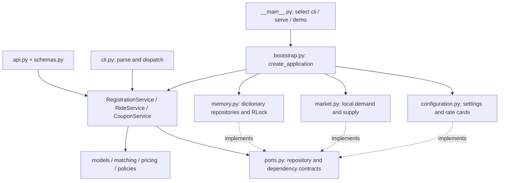
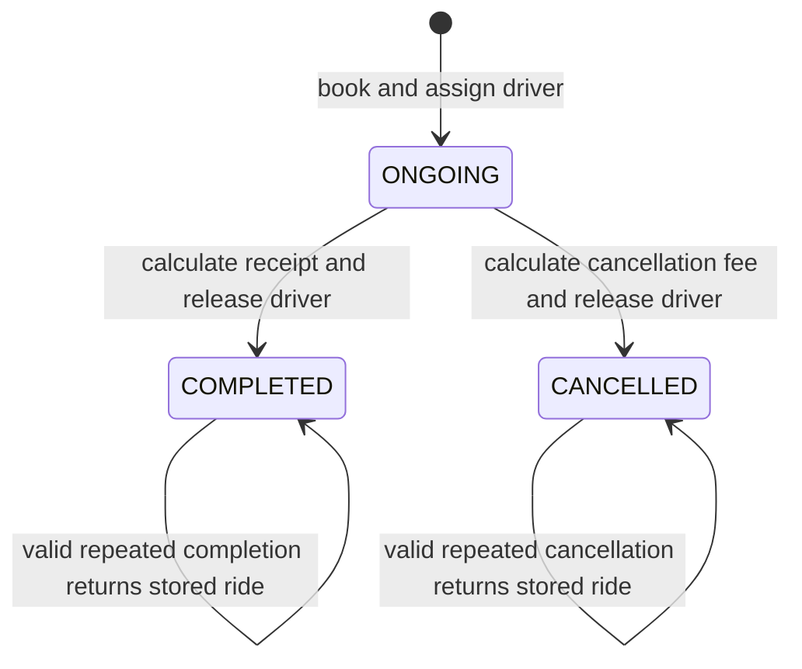

# Interview guide: your ride-hailing backend

This guide maps the implementation inspected on 15 October 2026. Source code is the authority where older project documentation differs. The assignment PDF is reference material for requirements and interview format; its instructions were not treated as a request to change the application.

## 1. Your opening explanation

> “This is a Python ride-hailing backend with a CLI and a FastAPI interface. Both call the same application services, so business rules are shared. The domain layer contains immutable models, matching rules, pricing, and cancellation policies. Services coordinate these rules through repository interfaces. The current repositories store data in memory, and one shared lock protects booking and lifecycle changes within one application process. Booking captures pricing terms so later configuration or coupon changes do not alter an existing ride.”

State assumptions early: one cab per driver; one ongoing ride per user and driver; booking starts the ride immediately; the default search radius is 5 km; billed distance is supplied on completion; state is lost on restart. This is a layered monolith with ports and adapters, not a set of independently deployed services.

## 2. Architecture and dependency direction



Solid arrows describe construction or calls; dotted arrows describe implementation of contracts. Application services import contracts rather than concrete dictionary repositories. Bootstrap knows the concrete implementations and connects them. The domain does not import FastAPI, Pydantic, or repositories.

An HTTP request goes through Pydantic request validation → application command → service → domain rules and repositories → domain result → Pydantic response serialization. A CLI command goes through argparse → the same application command and service → CLI JSON rendering. The CLI does not call the API.

## 3. File-by-file map

| File / entry point | Responsibility |
|---|---|
| [src/ride_app/__main__.py · main](/Users/adarshshukla/Documents/ChatGPT/uber-ride-app/src/ride_app/__main__.py:11) | Process entry point; chooses CLI/API/demo, loads optional TOML, starts one Uvicorn worker. |
| [src/ride_app/bootstrap.py · create_application](/Users/adarshshukla/Documents/ChatGPT/uber-ride-app/src/ride_app/bootstrap.py:57) | Composition root: constructs stores, one guard, selected strategies, and three services; injects clock and ID generator. |
| [src/ride_app/application/contracts.py](/Users/adarshshukla/Documents/ChatGPT/uber-ride-app/src/ride_app/application/contracts.py:1) | Frozen command dataclasses validate inputs shared by CLI and HTTP; no Pydantic dependency. |
| [src/ride_app/application/ports.py](/Users/adarshshukla/Documents/ChatGPT/uber-ride-app/src/ride_app/application/ports.py:1) | Protocols for repositories, rate cards, guard and market; callable clock and ID contracts. |
| [src/ride_app/application/registration_service.py · RegistrationService](/Users/adarshshukla/Documents/ChatGPT/uber-ride-app/src/ride_app/application/registration_service.py:9) | User/driver registration, duplicate-cab checks, location updates. |
| [src/ride_app/application/ride_service.py · RideService](/Users/adarshshukla/Documents/ChatGPT/uber-ride-app/src/ride_app/application/ride_service.py:29) | Coordinates booking, completion, cancellation, lookup and histories. |
| [src/ride_app/application/coupon_service.py · CouponService](/Users/adarshshukla/Documents/ChatGPT/uber-ride-app/src/ride_app/application/coupon_service.py:9) | Adds coupons and deactivates catalog entries; codes remain reserved. |
| [src/ride_app/domain/models.py](/Users/adarshshukla/Documents/ChatGPT/uber-ride-app/src/ride_app/domain/models.py:1) | Validated immutable entities and values: users, drivers, cabs, rides, rate cards, coupons, booking terms, receipts. |
| [src/ride_app/domain/matching.py · DriverMatcher](/Users/adarshshukla/Documents/ChatGPT/uber-ride-app/src/ride_app/domain/matching.py:64) | Haversine distance, radius/type eligibility, upgrade fallback, nearest/highest-rated ranking. |
| [src/ride_app/domain/pricing.py · PricingEngine](/Users/adarshshukla/Documents/ChatGPT/uber-ride-app/src/ride_app/domain/pricing.py:48) | Pure marginal pricing, minimum, surge, discount and receipt calculation. |
| [src/ride_app/domain/policies.py](/Users/adarshshukla/Documents/ChatGPT/uber-ride-app/src/ride_app/domain/policies.py:1) | MarketConditions, no-surge/demand-supply policies and free/grace-period cancellation policies. |
| [src/ride_app/domain/validation.py](/Users/adarshshukla/Documents/ChatGPT/uber-ride-app/src/ride_app/domain/validation.py:1) | Shared require, text normalization, Decimal/money and timestamp checks. |
| [src/ride_app/domain/errors.py · DomainError](/Users/adarshshukla/Documents/ChatGPT/uber-ride-app/src/ride_app/domain/errors.py:4) | Business error with stable code and message; independent of HTTP. |
| [src/ride_app/infrastructure/memory.py](/Users/adarshshukla/Documents/ChatGPT/uber-ride-app/src/ride_app/infrastructure/memory.py:1) | Four dictionary repositories and shared RLock context manager. |
| [src/ride_app/infrastructure/configuration.py · load_configuration](/Users/adarshshukla/Documents/ChatGPT/uber-ride-app/src/ride_app/infrastructure/configuration.py:128) | Default settings, all three car-type rate cards, strict TOML loader. |
| [src/ride_app/infrastructure/market.py · LocalMarketConditionsProvider](/Users/adarshshukla/Documents/ChatGPT/uber-ride-app/src/ride_app/infrastructure/market.py:9) | Local demand proxy and compatible available supply used by surge. |
| [src/ride_app/interfaces/api.py · create_api](/Users/adarshshukla/Documents/ChatGPT/uber-ride-app/src/ride_app/interfaces/api.py:34) | HTTP routes and error mapping; delegates to services. |
| [src/ride_app/interfaces/schemas.py](/Users/adarshshukla/Documents/ChatGPT/uber-ride-app/src/ride_app/interfaces/schemas.py:1) | Pydantic input/output schemas, conversion to domain values, money serialization. |
| [src/ride_app/interfaces/cli.py · execute_command](/Users/adarshshukla/Documents/ChatGPT/uber-ride-app/src/ride_app/interfaces/cli.py:88) | Argparse resource commands, dispatch, JSON rendering and interactive loop. |
| [src/ride_app/interfaces/demo.py · run_demo](/Users/adarshshukla/Documents/ChatGPT/uber-ride-app/src/ride_app/interfaces/demo.py:21) | Repeatable application-level demonstration with deterministic IDs/time. |
| [config/example.toml](/Users/adarshshukla/Documents/ChatGPT/uber-ride-app/config/example.toml:1) | Example enabling highest-rated matching, demand/supply surge, SUV upgrades and an extra pricing tier. |
| [pyproject.toml](/Users/adarshshukla/Documents/ChatGPT/uber-ride-app/pyproject.toml:1) | Python version, dependencies, console entry point and pytest/Ruff configuration. |
| [requirements-dev.lock](/Users/adarshshukla/Documents/ChatGPT/uber-ride-app/requirements-dev.lock:1) | Pinned development dependencies. |
| [README.md](/Users/adarshshukla/Documents/ChatGPT/uber-ride-app/README.md:1) | Setup, assumptions and basic usage; several feature descriptions are stale. |
| [.agent/prd.md](/Users/adarshshukla/Documents/ChatGPT/uber-ride-app/.agent/prd.md:1) | Earlier product specification; compare with code before quoting current feature scope. |
| [.agent/backendrules.md](/Users/adarshshukla/Documents/ChatGPT/uber-ride-app/.agent/backendrules.md:1) | Architecture rationale and diagrams; enum/scope descriptions predate current extensions. |
| [tests/README.md](/Users/adarshshukla/Documents/ChatGPT/uber-ride-app/tests/README.md:1) | Test suite overview. |

All `__init__.py` files mark packages and contain short package descriptions; business behavior lives in the modules above.

## 4. Domain objects to explain

| Object | Meaning and important invariant |
|---|---|
| `User` | Rider identity; history is queried from rides. |
| `Driver` + `Cab` | Driver owns one cab. Availability is derived from `active_ride_id is None`, avoiding a separate flag that can drift. Optional rating is 0–5. |
| `Location` | Finite latitude/longitude within geographic bounds. |
| `Ride` | Canonical trip; references user and driver IDs, records requested/assigned types, state and captured terms. |
| `PricingTier` + `RateCard` | Increasing cumulative boundaries; final tier is unbounded; immutable tuple of tiers. |
| `Coupon` + `CouponTerms` | Catalog activity is separate from immutable discount definition. |
| `BookingTerms` | Captures requested-type rates, coupon, surge multiplier, cancellation terms and allowed assignment types. |
| `FareBreakdown` | Distance charge + minimum adjustment + surge adjustment − discount must equal total. |
| `CancellationDetails` | Time, fee and reason, separate from a completed-trip receipt. |

`@dataclass(frozen=True, slots=True)` makes normal field assignment unavailable and avoids a per-instance attribute dictionary. `dataclasses.replace()` creates a new validated object for a state transition. Nested rate tiers are tuples, so a frozen outer object does not hide a mutable list. `object.__setattr__` inside initialization is used to normalize values while constructing frozen records.



Completion of a cancelled ride and cancellation of a completed ride are rejected. A valid repeat returns the stored result; it does not recompute charges or change the driver's current assignment.

## 5. Feature walkthroughs

### 1. Register a user

[src/ride_app/interfaces/api.py · register_user](/Users/adarshshukla/Documents/ChatGPT/uber-ride-app/src/ride_app/interfaces/api.py:103) → [src/ride_app/application/contracts.py · RegisterUserCommand](/Users/adarshshukla/Documents/ChatGPT/uber-ride-app/src/ride_app/application/contracts.py:11) → [src/ride_app/application/registration_service.py · register_user](/Users/adarshshukla/Documents/ChatGPT/uber-ride-app/src/ride_app/application/registration_service.py:24)

API: `POST /users`. CLI: `user register --name Alice`.

The command trims and validates the name. Inside the shared guard, the service creates a User with an injected ID, checks that the ID is unused, and saves it. Names are not unique identifiers; IDs are.

Say: “The adapter validates request shape; the command/model also validate rules so a CLI or direct Python caller cannot bypass them.”

### 2. Register a driver and cab

[src/ride_app/application/registration_service.py · register_driver](/Users/adarshshukla/Documents/ChatGPT/uber-ride-app/src/ride_app/application/registration_service.py:36) → [src/ride_app/domain/models.py · Driver](/Users/adarshshukla/Documents/ChatGPT/uber-ride-app/src/ride_app/domain/models.py:165)

API: `POST /drivers`. CLI: `driver register --name Bob --registration-number KA01 --type sedan --lat 12.97 --lng 77.59`.

The command normalizes the registration to uppercase, validates location/type and optional rating. The service checks duplicate registration under the shared guard, constructs Cab inside Driver, checks the generated ID, and saves. A new driver has no active ride and is available. No separate cab repository is needed for the one-cab-per-driver assumption.

### 3. Update cab location

[src/ride_app/application/registration_service.py · update_driver_location](/Users/adarshshukla/Documents/ChatGPT/uber-ride-app/src/ride_app/application/registration_service.py:62) → [src/ride_app/domain/models.py · update_location](/Users/adarshshukla/Documents/ChatGPT/uber-ride-app/src/ride_app/domain/models.py:196)

API: `PATCH /drivers/{driver_id}/location`. CLI: `driver location --driver DRIVER_ID --lat 12.97 --lng 77.59`.

The service finds the driver and saves a replacement Driver containing a replacement Cab at the new location. The same lock coordinates this with matching. Updates are allowed while busy, but busy drivers remain ineligible. Completion explicitly moves the cab to the supplied drop-off. These coordinates do not determine billed trip distance.

### 4. Book a ride

[src/ride_app/interfaces/api.py · book_ride](/Users/adarshshukla/Documents/ChatGPT/uber-ride-app/src/ride_app/interfaces/api.py:130) → [src/ride_app/application/contracts.py · BookRideCommand](/Users/adarshshukla/Documents/ChatGPT/uber-ride-app/src/ride_app/application/contracts.py:49) → [src/ride_app/application/ride_service.py · book_ride](/Users/adarshshukla/Documents/ChatGPT/uber-ride-app/src/ride_app/application/ride_service.py:72)

API: `POST /rides`. CLI: `ride book --user USER_ID --type hatchback --lat 12.97 --lng 77.59 --coupon SAVE10`.

Inside one shared critical section:

1. Require an existing user with no ongoing ride.
2. If supplied, require an existing active coupon.
3. Find available drivers and ask DriverMatcher to choose an eligible one.
4. Capture the requested-type rate card, coupon terms, surge multiplier, cancellation terms and upgrade permissions.
5. Create the ongoing Ride with generated ID and injected time; reject an ID collision.
6. Create the assigned Driver replacement.
7. Save the ride and driver, then return the ride.

Say: “The service coordinates the use case. It delegates matching and fare policy rather than embedding them in HTTP handlers.”

Actual code, lines 99–109:

```python
            # Billing follows requested type even if matching assigned an upgraded car.
            terms = BookingTerms(
                rate_card=self._rate_cards.get_for(command.requested_type),
                coupon_terms=coupon.terms if coupon else None,
                coupon_code=coupon.code if coupon else None,
                surge_multiplier=self._surge.multiplier(
                    self._market.snapshot(command.pickup, command.requested_type)
                ),
                cancellation_terms=self._cancellation_terms,
                allowed_assignment_types=self._upgrades.types_for(command.requested_type),
            )
```

### 5. Nearby matching and free upgrade

[src/ride_app/domain/matching.py · distance_km](/Users/adarshshukla/Documents/ChatGPT/uber-ride-app/src/ride_app/domain/matching.py:14) → [src/ride_app/domain/matching.py · DriverMatcher](/Users/adarshshukla/Documents/ChatGPT/uber-ride-app/src/ride_app/domain/matching.py:64) → [src/ride_app/domain/models.py · UpgradeRules](/Users/adarshshukla/Documents/ChatGPT/uber-ride-app/src/ride_app/domain/models.py:49)

Haversine calculates great-circle pickup distance. Filter to available drivers within the inclusive radius. Walk configured types in priority order and stop at the first nonempty type group. Then rank only that group.

Default routes: Hatchback → Hatchback, then Sedan; Sedan → Sedan; SUV → SUV. A nearer Sedan does not beat an eligible Hatchback. Default nearest ranking uses distance and then driver ID, giving deterministic ties. The matcher checks the strategy's answer belongs to the candidate set.

Free upgrade works because `requested_type` and `assigned_type` are separate, and booking calls `get_for(command.requested_type)`. A Sedan assigned to a Hatchback request receives Hatchback pricing. `Ride.is_upgrade` compares the types.

Actual code, lines 82–91:

```python
        eligible = tuple(
            driver
            for driver in drivers
            if driver.is_available and distance_km(pickup, driver.cab.location) <= radius_km
        )
        candidates = ()
        for car_type in self._upgrades.types_for(requested_type):
            candidates = tuple(driver for driver in eligible if driver.cab.car_type == car_type)
            if candidates:
                break
```

### 6. Tiered pricing, minimum and rounding

[src/ride_app/domain/pricing.py · calculate_distance_charge](/Users/adarshshukla/Documents/ChatGPT/uber-ride-app/src/ride_app/domain/pricing.py:16) → [src/ride_app/domain/pricing.py · PricingEngine](/Users/adarshshukla/Documents/ChatGPT/uber-ride-app/src/ride_app/domain/pricing.py:48) → [src/ride_app/infrastructure/configuration.py · ConfiguredRateCardCatalog](/Users/adarshshukla/Documents/ChatGPT/uber-ride-app/src/ride_app/infrastructure/configuration.py:57)

Each tier charges only its marginal segment, not the whole distance. Boundaries are cumulative: 2, 5, then unbounded. Fractional distances are prorated. Sum unrounded segment charges, then round once with `ROUND_HALF_UP` to ₹0.01.

Order: distance charge → minimum fare → captured surge → coupon → final total. `Decimal` is used for money and billed distance; geographic calculations use float.

| Default car | Minimum | First 2 km | Above 2–5 km | Above 5 km |
|---|---:|---:|---:|---:|
| Hatchback | ₹50 | ₹10/km | ₹8/km | ₹5/km |
| Sedan | ₹70 | ₹14/km | ₹11/km | ₹8/km |
| SUV | ₹100 | ₹20/km | ₹16/km | ₹12/km |

Worked example: 10 km Hatchback request, free Sedan assignment, 10% coupon, default no surge. Distance charge = 2×10 + 3×8 + 5×5 = ₹69. Minimum adds ₹0. Coupon subtracts ₹6.90. Final = **₹62.10**.

For 1 km: raw charge ₹10, minimum adjustment ₹40, subtotal ₹50. A 10% coupon makes it ₹45; the minimum applies before the discount. Sedan and SUV rates, default radius, and fractional-distance interpretation are implementation assumptions rather than all being specified numerically by the assignment.

Actual code, lines 21–28:

```python
        for tier in rate_card.tiers:
            upper = distance_km if tier.upper_bound_km is None else tier.upper_bound_km
            segment = max(Decimal("0"), min(distance_km, upper) - lower)
            charge += segment * tier.rate_per_km
            if distance_km <= upper:
                break
            lower = upper
        return round_money(charge)
```

Actual code, lines 53–63:

```python
            distance_charge = calculate_distance_charge(distance_km, terms.rate_card)
            base = max(distance_charge, terms.rate_card.minimum_fare)
            subtotal = round_money(base * terms.surge_multiplier)
            discount = calculate_discount(subtotal, terms.coupon_terms)
            return FareBreakdown(
                distance_charge=distance_charge,
                minimum_fare_adjustment=round_money(base - distance_charge),
                surge_adjustment=round_money(subtotal - base),
                discount=round_money(discount),
                total=round_money(subtotal - discount),
            )
```

### 7. Coupons: add, delete and apply

[src/ride_app/application/coupon_service.py · CouponService](/Users/adarshshukla/Documents/ChatGPT/uber-ride-app/src/ride_app/application/coupon_service.py:9) → [src/ride_app/domain/models.py · CouponTerms](/Users/adarshshukla/Documents/ChatGPT/uber-ride-app/src/ride_app/domain/models.py:256) → [src/ride_app/domain/pricing.py · calculate_discount](/Users/adarshshukla/Documents/ChatGPT/uber-ride-app/src/ride_app/domain/pricing.py:35)

API: `POST /coupons`, `DELETE /coupons/{code}`. CLI: `coupon add --code SAVE10 --percentage 10`, or `coupon add --code FLAT20 --flat 20`.

Codes are trimmed and uppercased. Percentage must be greater than zero and at most 100. Flat discounts must be positive whole-paise amounts. Deletion stores an inactive replacement; it does not remove the code or permit reuse.

Booking copies the immutable terms into the ride. Completion uses that snapshot, so deleting the coupon after booking does not remove the discount. Both discount kinds are capped at the subtotal, preventing a negative fare. There is one optional coupon per ride, with no expiry or usage limit.

HTTP accepts either `{ "code": "SAVE10", "percentage": "10" }` or `{ "code": "FLAT20", "discount_type": "flat", "value": "20" }`, exclusively.

### 8. Complete a ride and release its driver

[src/ride_app/application/ride_service.py · complete_ride](/Users/adarshshukla/Documents/ChatGPT/uber-ride-app/src/ride_app/application/ride_service.py:132) → [src/ride_app/domain/models.py · complete](/Users/adarshshukla/Documents/ChatGPT/uber-ride-app/src/ride_app/domain/models.py:473) → [src/ride_app/domain/models.py · release_ride](/Users/adarshshukla/Documents/ChatGPT/uber-ride-app/src/ride_app/domain/models.py:192)

API: `POST /rides/{ride_id}/complete`. CLI: `ride end --ride RIDE_ID --distance-km 10 --lat 13.01 --lng 77.64`.

The command rejects invalid distance/drop-off. Under the lock, return immediately if already completed; otherwise require ongoing status. Calculate from captured terms, construct the completed Ride, and construct the released Driver at drop-off before saving either.

The early return matters: the driver may already be serving another ride when an old completion is retried. Releasing before this check would corrupt the new assignment. `release_ride(ride.id)` also verifies the assignment ID. A valid repeat ignores differing new completion values and returns the stored result; this is lifecycle idempotency, not a general HTTP idempotency-key system.

Actual code, lines 134–150:

```python
        with self._guard.exclusive():
            ride = self._require_ride(command.ride_id)
            if ride.status == RideStatus.COMPLETED:
                return ride
            require(
                ride.status == RideStatus.ONGOING,
                "INVALID_RIDE_STATE",
                "Cancelled rides cannot be completed.",
            )
            driver = self._drivers.find_by_id(ride.driver_id)
            require(driver is not None, "DRIVER_NOT_FOUND", "Driver does not exist.")
            receipt = self._pricing.calculate(command.distance_km, ride.terms)
            completed = ride.complete(command.distance_km, command.dropoff, receipt, self._clock())
            released = driver.release_ride(ride.id).update_location(command.dropoff)
            self._rides.save(completed)
            self._drivers.save(released)
            return completed
```

### 9. Ride lookup and histories

[src/ride_app/application/ride_service.py · get_user_history](/Users/adarshshukla/Documents/ChatGPT/uber-ride-app/src/ride_app/application/ride_service.py:184) → [src/ride_app/application/ride_service.py · get_driver_history](/Users/adarshshukla/Documents/ChatGPT/uber-ride-app/src/ride_app/application/ride_service.py:194) → [src/ride_app/infrastructure/memory.py · InMemoryRideRepository](/Users/adarshshukla/Documents/ChatGPT/uber-ride-app/src/ride_app/infrastructure/memory.py:50)

API: `GET /rides/{ride_id}`, `GET /users/{user_id}/rides`, `GET /drivers/{driver_id}/rides`. CLI: `ride show`, `user rides`, `driver rides` with their ID flags.

Check the requested entity exists and query the canonical ride store. Histories include ongoing, completed and cancelled rides. They sort newest first, then ascending ID for equal start times. There are no separate mutable user-history and driver-history lists to synchronize.

### 10. Configurable ranking

[src/ride_app/domain/matching.py · HighestRatedDriverStrategy](/Users/adarshshukla/Documents/ChatGPT/uber-ride-app/src/ride_app/domain/matching.py:40) → [src/ride_app/bootstrap.py · create_application](/Users/adarshshukla/Documents/ChatGPT/uber-ride-app/src/ride_app/bootstrap.py:57) → [src/ride_app/infrastructure/configuration.py · Settings](/Users/adarshshukla/Documents/ChatGPT/uber-ride-app/src/ride_app/infrastructure/configuration.py:16)

The ranking Protocol exposes `select(candidates, pickup)`. Nearest ranks distance then ID. Highest-rated ranks rated drivers before unrated, then descending rating, ascending distance and ID. Eligibility and type priority stay in DriverMatcher.

Choose `nearest` or `highest_rated` in TOML; bootstrap creates the implementation. Python callers can inject a custom strategy. Ratings are supplied at registration; there is no post-trip rating workflow. Say: “Changing how candidates are ranked does not change booking orchestration or allow an ineligible car.”

### 11. Surge pricing

[src/ride_app/domain/policies.py · DemandSupplySurgePolicy](/Users/adarshshukla/Documents/ChatGPT/uber-ride-app/src/ride_app/domain/policies.py:38) → [src/ride_app/infrastructure/market.py · LocalMarketConditionsProvider](/Users/adarshshukla/Documents/ChatGPT/uber-ride-app/src/ride_app/infrastructure/market.py:9) → [src/ride_app/application/ride_service.py · book_ride](/Users/adarshshukla/Documents/ChatGPT/uber-ride-app/src/ride_app/application/ride_service.py:72)

Default policy is `none`, yielding multiplier 1. `demand_supply` uses:

`min(maximum, 1 + max(0, demand / max(1, supply) - 1) * sensitivity)`

Default cap is 3 and sensitivity 0.5. Demand is nearby ongoing rides of the requested type plus this request. Supply is nearby available drivers of compatible types. The snapshot is taken before reserving this driver. Demand is an exercise proxy, not measured waiting requests.

Example: demand 4, supply 2 gives 1.5×. A ₹69 base becomes ₹103.50; a 10% coupon makes ₹93.15. The multiplier is captured at booking, so completion does not use a later market reading. Zero supply is mathematically guarded, but booking still requires an eligible driver first.

### 12. Cancellation and fee policy

[src/ride_app/application/ride_service.py · cancel_ride](/Users/adarshshukla/Documents/ChatGPT/uber-ride-app/src/ride_app/application/ride_service.py:152) → [src/ride_app/domain/policies.py · GracePeriodCancellationPolicy](/Users/adarshshukla/Documents/ChatGPT/uber-ride-app/src/ride_app/domain/policies.py:64) → [src/ride_app/domain/models.py · CancellationDetails](/Users/adarshshukla/Documents/ChatGPT/uber-ride-app/src/ride_app/domain/models.py:100)

API: `POST /rides/{ride_id}/cancel`. CLI: `ride cancel --ride RIDE_ID --reason "Plans changed"`.

Under the shared guard, a repeated cancellation returns its stored result. Otherwise require ongoing status, calculate the fee from captured terms, stage cancelled ride and released driver, then save. Cancellation does not move the cab.

Default grace policy is free through 120 seconds inclusive, then ₹20. The free policy always returns zero. Cancellation records a fee; there is no payment collection integration. Coupons and trip fare calculations do not determine this fee.

### 13. Concurrency and failure handling

[src/ride_app/infrastructure/memory.py · InProcessMutationGuard](/Users/adarshshukla/Documents/ChatGPT/uber-ride-app/src/ride_app/infrastructure/memory.py:100) → [src/ride_app/bootstrap.py · create_application](/Users/adarshshukla/Documents/ChatGPT/uber-ride-app/src/ride_app/bootstrap.py:57) → [tests/test_ride_workflows.py · test_simultaneous_bookings_assign_one_driver_once](/Users/adarshshukla/Documents/ChatGPT/uber-ride-app/tests/test_ride_workflows.py:238)

All services share the same RLock. Two booking calls cannot both perform availability-check-and-assignment concurrently: the second enters after the first saves its reservation and finds no eligible free driver. Location and coupon changes use the same coordination boundary.

Construct and validate replacement objects before repository writes. This protects against the tested business/validation failures. It does not guarantee rollback after arbitrary storage failure or a process crash. One lock only protects one application instance in one process; it is not a database transaction or distributed lock. Separate CLI/API processes and multiple app instances have independent data.

### 14. Configuration and startup

[src/ride_app/__main__.py · main](/Users/adarshshukla/Documents/ChatGPT/uber-ride-app/src/ride_app/__main__.py:11) → [src/ride_app/infrastructure/configuration.py · load_configuration](/Users/adarshshukla/Documents/ChatGPT/uber-ride-app/src/ride_app/infrastructure/configuration.py:128) → [config/example.toml](/Users/adarshshukla/Documents/ChatGPT/uber-ride-app/config/example.toml:1)

`cli --config config/example.toml` and `serve --config config/example.toml` load settings once at startup. Unknown TOML keys are rejected. Decimal values retain precision, and rate overrides provide a complete version/minimum/tier schedule for that category. Omitted categories retain defaults.

The example changes behavior: highest-rated matching, enabled surge, SUV fallback and a fourth Hatchback tier after 10 km. Do not describe it as the default configuration. Demo mode creates its own deterministic default application and has no `--config` option.

### 15. HTTP/CLI validation and errors

[src/ride_app/interfaces/schemas.py · RequestModel](/Users/adarshshukla/Documents/ChatGPT/uber-ride-app/src/ride_app/interfaces/schemas.py:16) → [src/ride_app/interfaces/api.py · domain_error](/Users/adarshshukla/Documents/ChatGPT/uber-ride-app/src/ride_app/interfaces/api.py:48) → [src/ride_app/interfaces/cli.py · run_cli](/Users/adarshshukla/Documents/ChatGPT/uber-ride-app/src/ride_app/interfaces/cli.py:167)

HTTP schemas reject unknown fields and validate shape; domain commands/models enforce shared invariants. Errors have `{ "error": { "code": "...", "message": "..." } }`, with details for HTTP validation errors. Missing entities map to 404, assignment/duplicate/state conflicts to 409, and other invalid input to 422. Creation returns 201; coupon deletion returns 204. Money in HTTP receipts uses two-decimal strings.

The CLI catches expected domain and parser errors, keeps the session alive, and remembers failures so exit status is nonzero if any command failed. `GET /health` reports process responsiveness; it is not a database or external-service health check.

## 6. Tests to show the interviewer

The actual verification command was `.venv/bin/python -m pytest -q`. Latest result: **135 passed**, plus one dependency deprecation warning. The workspace received application/test updates during this review; the suite was rerun afterward. This task added only this guide.

- [tests/conftest.py](/Users/adarshshukla/Documents/ChatGPT/uber-ride-app/tests/conftest.py:1): Fresh application per test; deterministic clock and incrementing IDs.

- [tests/test_domain.py](/Users/adarshshukla/Documents/ChatGPT/uber-ride-app/tests/test_domain.py:1): Invalid coordinates/names, coupon percentages, ride invariants and receipt reconciliation.

- [tests/test_pricing.py](/Users/adarshshukla/Documents/ChatGPT/uber-ride-app/tests/test_pricing.py:1): Raw tier boundaries, minimums, category rates, rounding, coupons and configuration-only extra tier.

- [tests/test_matching.py](/Users/adarshshukla/Documents/ChatGPT/uber-ride-app/tests/test_matching.py:1): Known Haversine distances, nearest ties, exact-type priority, radius boundary and free fallback.

- [tests/test_ride_workflows.py](/Users/adarshshukla/Documents/ChatGPT/uber-ride-app/tests/test_ride_workflows.py:1): Lifecycle, histories, snapshots, no partial state on tested failures, retries and simultaneous booking.

- [tests/test_api.py](/Users/adarshshukla/Documents/ChatGPT/uber-ride-app/tests/test_api.py:1): HTTP lifecycle, serialization, error mapping, health and OpenAPI.

- [tests/test_cli.py](/Users/adarshshukla/Documents/ChatGPT/uber-ride-app/tests/test_cli.py:1): Interactive lifecycle, recovery from errors, help/EOF and deterministic demo.

The first run found an API receipt expectation missing `surge_adjustment`. A concurrent workspace update corrected it and added an extension suite; the latest full run passes.

- [tests/test_extensions.py](/Users/adarshshukla/Documents/ChatGPT/uber-ride-app/tests/test_extensions.py:1): highest-rated ranking, surge formula and local market snapshots, flat coupons, cancellation boundaries/retries/races, SUV upgrades, TOML configuration, and bonus API/CLI paths.

A strong testing explanation: “I test raw distance charges separately because a minimum fare can conceal an incorrect tier calculation. I also test state after failures, not just error codes, and retry completion after the driver has taken another ride.”

## 7. Likely interview questions and answers

| Question | Answer grounded in this code |
|---|---|
| Why these layers? | HTTP/CLI formatting, use-case coordination, business rules and storage change for different reasons. Shared services prevent adapter divergence. |
| Why Protocol instead of a base class? | Structural typing expresses the operations a collaborator must provide without requiring inheritance. It is primarily a typing contract, not automatic runtime enforcement. |
| Why dependency injection? | Bootstrap selects implementations; tests supply deterministic IDs/time or replacement policies without global patching. |
| Why immutable objects? | Callers cannot normally mutate stored records behind service checks. Transitions construct validated replacements, and old pricing terms remain stable. |
| Is a free upgrade a discount? | No. It assigns a higher category but selects the requested category's rate card. Coupons are applied independently. |
| Why not a subclass per vehicle? | Current categories differ in data and permitted assignment routes. A shared model plus configured rates avoids duplicated behavior. |
| Why not float for money? | Binary floating-point representation can distort decimal amounts. Decimal plus explicit rounding defines predictable billing. |
| Can two users get the same driver? | Not through these services in the same app instance: the shared lock covers check and reservation. Separate processes require database coordination. |
| Are operations transactional? | No rollback transaction. Validated replacements are staged before simple in-memory writes; a durable database needs actual transactions. |
| What is the matching complexity? | Linear scans over drivers; ranking uses `min`, not sorting. Surge also scans rides/drivers. History filters all rides then sorts the matching results. |
| What changes for production? | Durable repositories plus transactional reservation/uniqueness constraints, indexes, authentication/authorization, trusted distance collection and payment integration. |
| Does the CLI share API data? | No. Both reuse the same service code but separately launched processes have separate dictionaries. |
| Is booking idempotent? | No request-key deduplication. A repeat while the user is active is rejected; completion/cancellation have explicit terminal-state repeat behavior. |
| What does “end ride” trust? | A supplied nonnegative Decimal distance, not GPS-derived route length. Haversine is only for pickup proximity. |
| How did you use AI? | Describe your actual process truthfully. The README records AI assistance; explain the code decisions you can defend, especially snapshots, requested vs assigned types and retry safety. |

## 8. Live extension map

| Interview change | Where to edit | What to verify |
|---|---|---|
| Add another pricing tier | Rate-card data in configuration.py or complete TOML override | Below/at/above boundary and raw charge; no booking rewrite. |
| Add another vehicle category | CarType, default UpgradeRules coverage and default rate catalog | Exact match, allowed fallback, category fare and snapshot assignment validation. SUV already exists. |
| Add a matching strategy | Implement `select`; inject directly or add named config/bootstrap selection | Ranking/ties and that eligibility remains enforced. |
| Add a coupon kind | DiscountType, CouponTerms validation, pricing branch and adapter inputs | Validation, capping, rounding and booking snapshot. Flat already exists. |
| Add persistence | Implement repository ports and redesign mutation coordination around transactions | Concurrent reservations, unique registrations, failure rollback, restart survival. |
| Add another cancellation policy | Implement `calculate(ride, cancelled_at)` and wire/configure it | Time boundaries, captured terms, retries and driver release. |

Avoid claiming every extension changes only configuration: a brand-new enum category or discount algorithm still requires code and tests.

## 9. Interview walkthrough order

For the assignment's eight-minute code/design segment:

1. **0:00–1:00:** Show architecture and `bootstrap.create_application`; explain shared services and dependency injection.
2. **1:00–2:00:** Show Driver, Ride and BookingTerms; explain availability, lifecycle and immutable snapshots.
3. **2:00–4:00:** Open `RideService.book_ride`, then `DriverMatcher.match`; narrate validation, exact-type priority, upgrade and reservation.
4. **4:00–5:30:** Open PricingEngine; calculate the ₹62.10 example and explain Decimal/rounding.
5. **5:30–6:30:** Show completion's early return and shared guard; explain retries and concurrency limits.
6. **6:30–7:30:** Point to tier, snapshot and concurrency tests; report the latest 135-test passing result.
7. **7:30–8:00:** Describe one extension boundary and production trade-off.

For the working demo, run `.venv/bin/python -m ride_app demo` from the project root. It exercises minimum fare, free upgrade, a coupon deleted after booking, histories and expected no-driver/invalid-coupon errors. It does not demonstrate every bonus feature. For an interactive default session use `.venv/bin/python -m ride_app cli`; for HTTP use `.venv/bin/python -m ride_app serve` and open `/docs`.

## 10. Accuracy notes before the interview

The README and earlier design documents describe several implemented features as future work: surge, alternate ranking, cancellation, flat discounts and SUV support. Some source docstrings also predate those additions. Use the function behavior and current schemas above when explaining scope.

Default surge is disabled, but cancellation defaults to a grace-period fee. Default upgrades exclude SUV; the example TOML enables them. The current suite covers both mandatory behavior and extensions. Passing tests support the modeled cases; they do not establish production durability or distributed safety.
