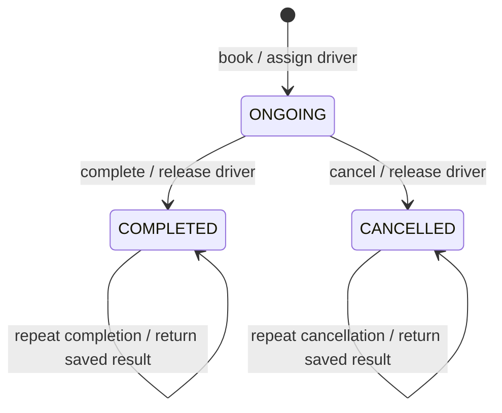

# Customizing the ride backend

The mandatory scope was already implemented. The four assignment bonuses are now implemented: demand/supply surge, selectable matching, cancellation fees, and concurrency safety within one process. SUV and flat coupons demonstrate the live-extension examples from the assignment.

## Choose the smallest change

| Requested change | Change here | Verification |
| --- | --- | --- |
| Search within 8 km | `matching.radius_km` in TOML | Inside/outside radius and inclusive boundary |
| Add a distance tier / change minimum | Complete `rates.<type>` override | Raw tier boundary, minimum and final receipt |
| Prefer highest-rated drivers | `matching.strategy = "highest_rated"` | Eligibility, type precedence, tie-breakers |
| Allow Sedan requests to use SUV | `upgrades.sedan = ["sedan", "suv"]` | Requested type first; Sedan billing after upgrade |
| Change surge cap or response | `surge.maximum` / `surge.sensitivity` | Thresholds, cap, booking snapshot |
| Disable surge | `surge.policy = "none"` | Baseline fares unchanged |
| Change cancellation grace / fee | `cancellation.grace_seconds` / `fee` | Exact boundary and one second later |
| Make cancellation free | `cancellation.policy = "free"` | Fee zero after grace period too |
| Add a flat coupon | CLI `coupon add --code FLAT20 --flat 20` or API | Cap at subtotal; deletion preserves booked terms |
| Different matching algorithm | Implement `MatchingStrategy.select`; inject at bootstrap | Return an eligible candidate, deterministic ties |
| Different surge algorithm | Implement `SurgePolicy.multiplier`; inject | Finite Decimal >= 1; snapshot remains stable |
| Real demand measurement | Implement `MarketConditionsProvider.snapshot`; inject | Geography/category meaning, no mutation |
| Different cancellation formula | Implement `CancellationFeePolicy.calculate`; inject | Nonnegative whole-paise result and retry safety |
| Another car type | Enum, default rate card, default upgrade route, tests | Registration, matching, fare, CLI/API |
| Persistent storage | Repository adapters plus actual transactions | Concurrent assignment, rollback, uniqueness |

Copy `config/example.toml`, change values and pass `--config PATH` to `cli` or `serve`. Unspecified sections keep defaults; a rate-card override must supply version, minimum and its complete tier list. Omit the upper bound only on the final tier. Use decimal strings for money. Unknown fields fail startup instead of silently falling back.

Configuration is loaded once. A restart applies changes to a new in-memory context and loses the previous data. There is no hot reload or administrative configuration endpoint. API clients cannot choose an arbitrary surge multiplier, fee or rate card.

## What SOLID means here

- **Single responsibility:** services coordinate use cases; domain policies calculate/rank; repositories store records; CLI/API translate input and output. The market adapter reads supply/demand; the surge policy computes the multiplier. Cancellation fee calculation is separate from releasing a driver.
- **Open/closed:** new ranking, surge and cancellation algorithms can implement a narrow protocol and be injected without rewriting booking/completion. Rate tiers and upgrade routes are data. Adding a new category still intentionally changes the enum and default configuration; open/closed does not mean every possible product change requires zero edits.
- **Liskov substitution:** all ranking implementations receive already eligible candidates and must return one of them. All surge policies return a finite Decimal at least 1. All cancellation policies return nonnegative whole-paise amounts without mutation. Snapshot/entity validation rejects invalid results before storage writes. Behavior and contract tests protect these guarantees.
- **Interface segregation:** separate protocols exist for matching, surge, cancellation, market observations and each repository. A surge algorithm does not need CRUD methods, HTTP context or a full application object.
- **Dependency inversion:** application orchestration uses repository and policy contracts; bootstrap chooses implementations. Domain records do not depend on FastAPI, Pydantic, TOML or memory dictionaries. Concrete pure PricingEngine and DriverMatcher remain cohesive domain collaborators; unnecessary interfaces for every class would not improve this design.

`RideService` deliberately owns the short booking/completion/cancellation workflows together because they share the same lifecycle and atomicity boundary. Split it only if its responsibilities materially grow. Percentage versus flat discount remains one small calculation branch; a plugin framework would add more complexity than these two formulas justify.

## Implement a new policy

For example, a pilot area might use a fixed surge multiplier:

```python
from decimal import Decimal
from ride_app.bootstrap import create_application
from ride_app.domain.policies import MarketConditions

class PilotSurge:
    def multiplier(self, market: MarketConditions) -> Decimal:
        return Decimal("1.25")

app = create_application(surge_policy=PilotSurge())
```

The application captures `1.25` in each new ride's `BookingTerms`. Completion uses that stored value, never current supply or demand. To select the new algorithm by TOML name, also add that name to Settings validation and the composition root. Runtime configuration only selects known implementations; it does not load arbitrary Python paths.

Custom matching follows the existing `select(candidates, pickup)` contract. DriverMatcher retains availability, radius and ordered category selection. A strategy must not bypass eligibility by loading another driver itself.

Custom cancellation follows `calculate(ride, cancelled_at)`. Use `ride.terms.cancellation_terms` for captured grace/fee and the supplied timestamp. Do not read current configuration or mutate repositories. If a new formula needs additional historical data, add validated immutable fields to booking terms and their API representation first. Policy objects are fixed for an application lifetime; changing their code/behavior during ongoing rides is not supported.

## Pricing and snapshots

The calculation order is explicit:

1. Sum marginal distance tiers and round the combined charge with ROUND_HALF_UP.
2. Apply the requested car type's minimum fare.
3. Multiply by the captured surge multiplier and round.
4. Calculate percentage or flat discount, round it, and cap it at the subtotal.
5. Store a reconciled receipt: distance + minimum adjustment + surge adjustment - discount = total.

Example: a 10 km Hatchback trip costs 69 before surge. With 1.5x surge and a flat 20 coupon it costs 83.50. A free SUV upgrade uses the same requested Hatchback rates. A 100% coupon reduces the final fare to zero.

Rates, coupon terms, surge, cancellation terms and permitted assignment types are immutable booking data. This prevents later coupon deletion or rate-catalog changes from altering an existing trip. New pricing behavior should preserve that property.

## Surge assumptions

Default surge is off. With `demand_supply` enabled, the local provider uses:

- Demand: ongoing rides of the requested type whose pickups are within the configured radius, plus this incoming request.
- Supply: available nearby drivers in any configured compatible category, before reserving the selected driver.
- Formula: `min(maximum, 1 + max(0, demand / max(1, supply) - 1) * sensitivity)`.

This active-ride count is an exercise proxy, not actual unmet-demand telemetry. Two nearby drivers and two overlapping requests yield 1x for the first booking, then 1.5x for the second at default sensitivity. Completed/cancelled rides stop contributing. No supply still produces a booking error, not a guaranteed reservation at a high price.

A production telemetry adapter should provide cached coherent observations. Do not perform slow remote calls while holding the process-wide lock. A distributed deployment needs a different transaction/coordination design.

## Cancellation and concurrency

Booking starts the ride immediately. Cancellation is allowed while ONGOING, measured from `started_at`; default is free through exactly 120 seconds and 20 afterwards. It does not bill partial distance. Surge/coupons do not modify the cancellation fee, and no payment gateway is called.



Completed rides require completion data; cancelled rides require cancellation details and no completion data. Both prevent further transitions. Cancellation retains the cab's latest reported location. Retries return before touching the driver, including after that driver starts a newer ride.

One shared RLock serializes competing lifecycle operations. Tests coordinate races with a barrier, not timing sleeps. Database support would additionally require a transaction around the ride/driver writes and uniqueness/locking guarantees. Separate API workers or CLI processes do not share the in-memory store or lock.

## Verify a future change

Start with the affected policy or workflow test. Assert boundary/intermediate values, not just final totals: minimum fares can mask tier bugs. Cover failed operations leaving ride and driver unchanged, snapshots, and relevant terminal-state races. Then run the full suite and both adapter checks:

```bash
.venv/bin/python -m pytest -q
.venv/bin/python -m ruff check src tests
.venv/bin/python -m ruff format --check src tests
.venv/bin/python -m compileall -q src
.venv/bin/python -m pip check
```

Update the PRD, backend rules and README whenever the behavior contract changes. For an interview extension, explain the changed data/policy, run its focused test and show one CLI/API example.
